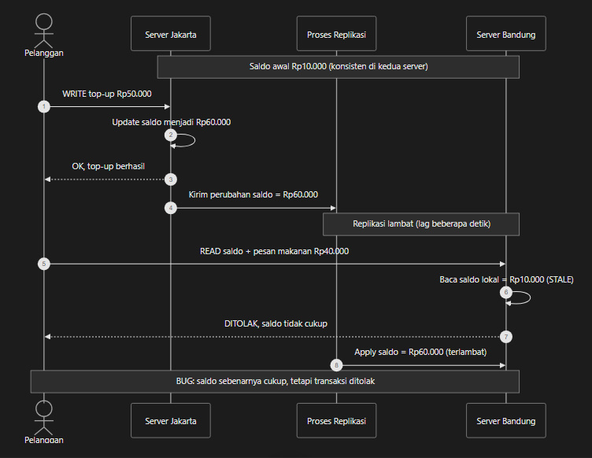
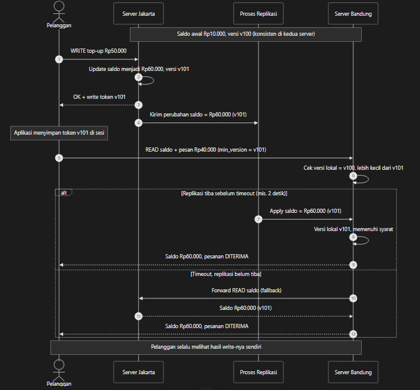
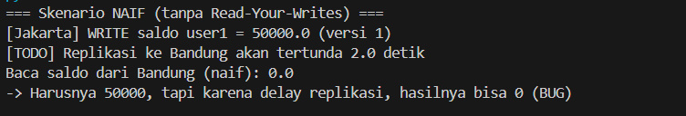
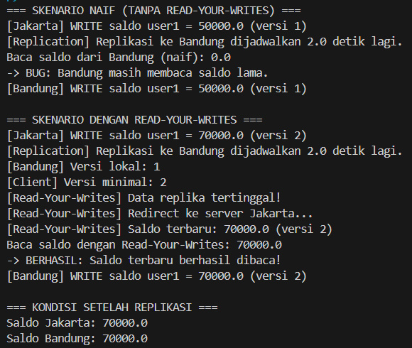

# Tugas 7 (Pekan 7) — Konsistensi Data

**Materi terkait:** Data-Centric Consistency (Sequential, Eventual), Client-Centric Consistency.

## Studi Kasus

Data saldo *e-wallet* pelanggan FoodGo berbeda antara server wilayah **Jakarta** dan **Bandung** karena replikasi antar server berjalan lambat. Contoh kasus nyata: pelanggan top-up saldo lewat server Jakarta, lalu dalam hitungan detik memesan makanan lewat aplikasi yang tersambung ke server Bandung — saldo belum ter-update, transaksi ditolak padahal saldo sebenarnya cukup.

## Tugas Kelompok

### Bagian 1 — Analisis (wajib)

## 1. Pemilihan Model Konsistensi: Sequential Consistency atau Eventual Consistency

Kasus saldo e-wallet FoodGo lebih membutuhkan jaminan konsistensi yang kuat dibandingkan hanya menggunakan Eventual Consistency.

**Alasan:**

- **Eventual Consistency** memungkinkan setiap replika memiliki data yang berbeda untuk sementara waktu sampai proses replikasi selesai. Model ini cocok untuk data yang tidak terlalu sensitif, seperti jumlah like atau jumlah tayangan di media sosial, karena perbedaan data sementara tidak menimbulkan dampak bisnis yang besar.
- **Sequential Consistency** memastikan semua replika melihat urutan operasi yang sama, sehingga perubahan data dapat dipahami dalam urutan yang konsisten. Hal ini lebih relevan untuk sistem transaksi seperti e-wallet karena urutan top-up dan pembayaran sangat penting.
- Jika hanya menggunakan Eventual Consistency, pelanggan yang sudah melakukan top-up melalui server Jakarta bisa mengalami penolakan transaksi ketika mengakses server Bandung karena saldo yang terbaca masih saldo lama.
- Kondisi tersebut dapat menimbulkan kerugian bisnis, mengurangi kepercayaan pelanggan, dan mengganggu proses transaksi.

**Kesimpulan:**

Eventual Consistency saja tidak cukup untuk sistem saldo e-wallet FoodGo karena data saldo berkaitan langsung dengan transaksi keuangan. Sequential Consistency lebih baik dalam menjaga kesamaan urutan operasi yang terlihat oleh replika. Namun, untuk menjamin keamanan transaksi keuangan, sistem juga membutuhkan mekanisme konsistensi yang lebih kuat, seperti transaksi atomik dan pengendalian akses saldo agar tidak terjadi transaksi ganda (*double spending*).

## 2. Pendekatan Client-Centric Consistency

Pendekatan Client-Centric Consistency yang diusulkan adalah **Read-Your-Writes Consistency**.

Read-Your-Writes merupakan mekanisme yang memastikan pelanggan dapat membaca hasil perubahan data yang sebelumnya telah dilakukan sendiri, meskipun pelanggan berpindah dan mengakses server yang berbeda.

**Cara kerja solusi:**

1. Pelanggan melakukan top-up saldo sebesar Rp50.000 melalui server Jakarta.
2. Server Jakarta memperbarui saldo pelanggan dari Rp10.000 menjadi Rp60.000.
3. Setelah berhasil, server Jakarta memberikan informasi versi data terbaru, misalnya versi 101, kepada aplikasi pelanggan.
4. Pelanggan menyimpan token versi 101 tersebut.
5. Ketika pelanggan berpindah ke server Bandung untuk memesan makanan, aplikasi mengirimkan permintaan pembacaan saldo beserta informasi versi minimal 101.
6. Server Bandung memeriksa versi data lokal. Jika masih berada pada versi 100, berarti data belum diperbarui.
7. Sistem kemudian mengarahkan permintaan ke server Jakarta yang sudah memiliki data versi 101, atau menunggu hingga replikasi selesai.
8. Pelanggan memperoleh saldo terbaru sebesar Rp60.000 sehingga dapat melanjutkan transaksi.

**Kesimpulan:**

Dengan menerapkan Read-Your-Writes, pelanggan tidak akan membaca saldo lama setelah melakukan top-up, meskipun server yang diakses belum menerima pembaruan data. Pendekatan ini dapat mengurangi kesalahan pembacaan saldo dan meningkatkan pengalaman serta kepercayaan pelanggan terhadap layanan FoodGo.

Selain itu, proses pembayaran tetap harus menggunakan transaksi atomik untuk memastikan saldo hanya dikurangi satu kali dan tidak terjadi pengeluaran saldo secara bersamaan.


## 3. Sequence Diagram

### A. Skenario Tanpa Jaminan Konsistensi (Bug Terjadi)



**Analisis:**

Pada skenario ini, keterlambatan replikasi menyebabkan
server Bandung masih membaca saldo lama sebesar Rp10.000,
padahal saldo sebenarnya sudah menjadi Rp60.000.
Akibatnya, pesanan sebesar Rp40.000 ditolak karena
server Bandung belum menerima pembaruan saldo.

### B. Skenario Dengan Read-Your-Writes (Bug Teratasi)



**Analisis:**

Pada skenario ini, sistem menggunakan mekanisme
Read-Your-Writes dengan token versi data.
Ketika pelanggan melakukan top-up, server Jakarta
memberikan token versi terbaru kepada pelanggan.

Saat pelanggan mengakses server Bandung, sistem
memeriksa versi data lokal. Jika versi lokal tertinggal,
permintaan diarahkan ke server yang memiliki data terbaru.
Dengan demikian, pelanggan dapat menggunakan saldo
terbarunya untuk melakukan transaksi.

## Bagian 2 — Simulasi Replikasi Dua Server

### 1. Menunjukkan Kondisi Inconsistent Read

Pada skenario ini, pelanggan melakukan top-up sebesar
Rp50.000 melalui server Jakarta. Saldo Jakarta berhasil
diperbarui menjadi Rp50.000 dengan versi data 1.

Namun, karena terdapat keterlambatan replikasi selama
2 detik, server Bandung masih menyimpan saldo lama
sebesar Rp0

Ketika pelanggan membaca saldo melalui server Bandung
sebelum proses replikasi selesai, sistem masih
menampilkan saldo Rp0. Hal ini menyebabkan terjadinya
inconsistent read, yaitu kondisi ketika replika
membaca data yang belum diperbarui.

**Hasil yang diperoleh:**



- Saldo Jakarta: Rp50.000
- Saldo Bandung: Rp0
- Status: Inconsistent Read 
- Penyebab: Keterlambatan proses replikasi.

### 2. Implementasi Read-Your-Writes

Untuk mengatasi permasalahan tersebut, diterapkan
mekanisme Read-Your-Writes menggunakan version tracking.

Setiap perubahan saldo akan menghasilkan versi data
terbaru. Setelah pelanggan melakukan top-up, aplikasi
menyimpan informasi versi terakhir yang diterima.

Ketika pelanggan membaca saldo melalui server Bandung,
sistem membandingkan versi data lokal dengan versi minimal
yang diminta oleh pelanggan.

Jika versi Bandung lebih rendah, sistem akan mengarahkan
permintaan pembacaan ke server Jakarta yang memiliki
data terbaru.

**Hasil yang diperoleh:**



- Top-up pertama: Rp50.000.
- Top-up kedua: Rp20.000.
- Saldo Jakarta: Rp70.000.
- Versi Jakarta: 2.
- Versi Bandung: 1 (belum menerima replikasi kedua).
- Sistem mendeteksi bahwa versi Bandung tertinggal.
- Permintaan pembacaan dialihkan ke server Jakarta.
- Saldo terbaru sebesar Rp70.000 berhasil dibaca.

**Kesimpulan:**

Implementasi Read your writes berhasil mengatasi
permasalahan inconsistent read dengan memanfaatkan
pengecekan versi data dan pengalihan permintaan ke
server yang memiliki data terbaru.

Dengan mekanisme ini, pelanggan dapat membaca hasil
perubahan saldo miliknya sendiri tanpa harus menunggu
proses replikasi selesai.

## Struktur Submission

```
tugas-07-konsistensi-data/
├── README.md      # Analisis konsistensi + sequence diagram Mermaid
├── JURNAL.md
├── src/            # (opsional) simulasi replikasi
└── bukti/          # (jika mengerjakan simulasi) output program
```

## Rubrik Penilaian (Tugas 7)

| Komponen | Bobot | Kriteria |
|---|---|---|
| Ketepatan pemilihan model konsistensi | 30% | Argumen berbasis dampak bisnis nyata, bukan hafalan definisi |
| Kualitas sequence diagram | 30% | Menunjukkan jelas titik kegagalan & titik perbaikan |
| Usulan solusi client-centric | 25% | Solusi konkret dan dapat diimplementasikan (bukan wacana abstrak) |
| Proses & kontribusi kelompok | 15% | `JURNAL.md`, commit history (+ bonus jika simulasi dikerjakan) |

## Batasan Penggunaan AI (Level 2)

Kebijakan **Level 2 (AI Assisted Idea Generation & Structuring)** berlaku — lihat [`../RUBRIK-UMUM.md`](../RUBRIK-UMUM.md). Boleh bertanya konsep umum consistency model ke AI untuk brainstorming; **tidak boleh** meminta AI menuliskan analisis akhir/sequence diagram atau isi `# TODO` di `src/replica_simulation.py` yang tinggal ditempel. Catat pemakaian AI di "Log Penggunaan AI" pada `JURNAL.md`.

- Sebagai bukti pemahaman konsep (bukan hafalan jawaban skenario FoodGo saja), `README.md` wajib menyertakan **satu skenario tambahan** yang kalian buat sendiri (mis. kasus lain di aplikasi ojek online) dan menentukan model konsistensi yang tepat untuk skenario tambahan tersebut.
