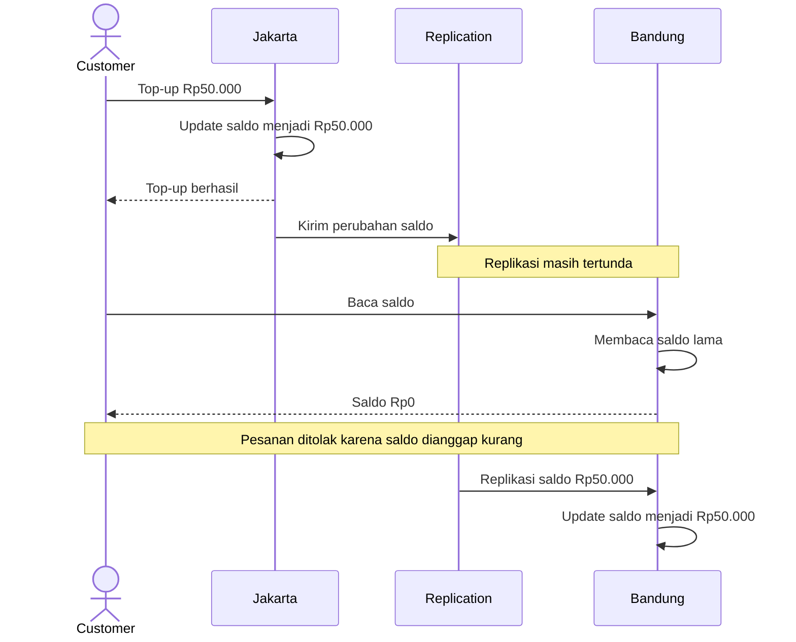
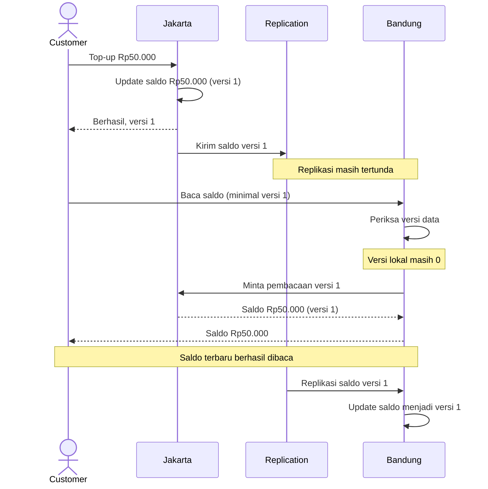

# Tugas 7 (Pekan 7) — Konsistensi Data

## 1. Studi Kasus

FoodGo memiliki dua server yang berada di wilayah Jakarta dan Bandung. Kedua server menyimpan data saldo e-wallet pelanggan melalui proses replikasi.

Masalah terjadi ketika pelanggan melakukan top-up saldo melalui server Jakarta. Saldo di Jakarta berhasil diperbarui, tetapi perubahan tersebut belum langsung diterima oleh server Bandung karena adanya keterlambatan replikasi.

Beberapa detik kemudian, pelanggan menggunakan server Bandung untuk melakukan pemesanan makanan. Server Bandung masih menyimpan saldo lama sehingga pesanan ditolak, meskipun pelanggan sebenarnya sudah memiliki saldo yang cukup.

Permasalahan ini menunjukkan adanya perbedaan data antar-replika atau *data inconsistency*.

## 2. Analisis Model Konsistensi

Pada kasus FoodGo, terdapat dua model konsistensi yang dapat dipertimbangkan, yaitu Sequential Consistency dan Eventual Consistency.

### 2.1 Sequential Consistency

Sequential Consistency merupakan model konsistensi yang mengharuskan seluruh proses melihat urutan operasi yang sama, seolah-olah operasi tersebut dijalankan secara berurutan. Urutan operasi dari masing-masing proses juga harus tetap dipertahankan.

Jika model ini diterapkan pada FoodGo, operasi top-up dan pembacaan saldo pelanggan harus mengikuti urutan yang konsisten. Dengan demikian, pembacaan setelah top-up tidak boleh mendahului operasi top-up tersebut dalam urutan yang diamati pelanggan.

Kelebihannya adalah urutan operasi lebih terjaga. Namun, penerapannya membutuhkan koordinasi antar-replika sehingga dapat menambah komunikasi dan waktu pemrosesan.

### 2.2 Eventual Consistency

Eventual Consistency merupakan model konsistensi yang memperbolehkan data pada beberapa replika berbeda untuk sementara waktu. Namun, apabila tidak ada pembaruan baru dan proses replikasi berjalan dengan baik, seluruh replika pada akhirnya akan memiliki data yang sama.

Jika diterapkan pada FoodGo, server Jakarta dapat memperbarui saldo terlebih dahulu, kemudian mengirimkan perubahan tersebut ke Bandung. Selama proses replikasi belum selesai, server Bandung masih mungkin membaca saldo sebelumnya.

Kelebihannya adalah sistem tidak harus menunggu semua replika diperbarui setiap kali terjadi perubahan. Namun, kekurangannya adalah pelanggan dapat memperoleh data yang sudah tidak terbaru.

### 2.3 Perbandingan Model Konsistensi

| Aspek | Sequential Consistency | Eventual Consistency |
|---|---|---|
| Urutan operasi | Seluruh proses melihat urutan operasi yang sama | Replika dapat memiliki kondisi sementara yang berbeda |
| Sinkronisasi | Membutuhkan koordinasi untuk menjaga urutan | Tidak harus menunggu semua replika diperbarui |
| Pembacaan data | Mengikuti urutan operasi yang konsisten | Dapat membaca data lama sementara waktu |
| Kelebihan | Urutan operasi lebih terjaga | Lebih fleksibel dalam proses replikasi |
| Kekurangan | Koordinasi dapat menambah waktu pemrosesan | Berisiko menghasilkan pembacaan data yang belum terbaru |

### 2.4 Model yang Dipilih

Model yang dipilih untuk skenario ini adalah Eventual Consistency dengan tambahan mekanisme Client-Centric Consistency, yaitu Read-Your-Writes.

Pertimbangannya adalah FoodGo memiliki beberapa server wilayah yang melakukan replikasi data. Penggunaan Eventual Consistency memungkinkan perubahan saldo dikirimkan secara bertahap tanpa harus menunggu seluruh server selesai diperbarui.

Namun, Eventual Consistency saja belum cukup untuk kasus pelanggan yang langsung melakukan pemesanan setelah top-up. Oleh karena itu, diperlukan Read-Your-Writes agar pelanggan dapat melihat hasil perubahan saldo yang sebelumnya dilakukan.

Untuk transaksi e-wallet, mekanisme ini tetap harus disertai validasi saldo pada server yang berwenang. Read-Your-Writes hanya membantu menjamin pembacaan perubahan milik pelanggan, bukan menjamin keamanan seluruh transaksi secara bersamaan.

## 3. Solusi Client-Centric Consistency

### 3.1 Read-Your-Writes

Read-Your-Writes merupakan salah satu model Client-Centric Consistency. Model ini menjamin bahwa hasil operasi write yang dilakukan oleh suatu proses akan terlihat pada operasi read berikutnya oleh proses yang sama.

Pada kasus FoodGo, mekanismenya dapat diterapkan sebagai berikut:

1. Pelanggan melakukan top-up saldo melalui server Jakarta.
2. Server Jakarta menyimpan saldo baru dan memberikan informasi versi data.
3. Pelanggan melakukan pemesanan melalui server Bandung.
4. Server Bandung memeriksa versi data yang dimiliki.
5. Jika versi data Bandung masih lebih lama, pembacaan diarahkan ke server Jakarta yang sudah memiliki versi terbaru.
6. Server mengembalikan saldo terbaru kepada pelanggan.

Dengan mekanisme tersebut, pelanggan tidak lagi hanya bergantung pada data lama yang tersimpan di server Bandung.

### 3.2 Penggunaan Versi Data

Setiap perubahan saldo diberikan nomor versi. Contohnya, setelah pelanggan melakukan top-up, saldo di Jakarta memiliki versi 1.

Ketika pelanggan berpindah ke Bandung, sistem membandingkan versi data Bandung dengan versi minimal yang dibutuhkan pelanggan.

Jika versi Bandung belum memenuhi versi tersebut, sistem dapat mengarahkan pembacaan ke Jakarta. Setelah replikasi selesai, Bandung juga akan memiliki versi yang sama.

## 4. Sequence Diagram Tanpa Solusi

Diagram berikut menunjukkan kondisi ketika pelanggan melakukan top-up di Jakarta, kemudian langsung membaca saldo melalui Bandung sebelum proses replikasi selesai.

Pada diagram tersebut, pelanggan sudah berhasil melakukan top-up di Jakarta. Namun, ketika membaca saldo melalui Bandung, perubahan belum diterima sehingga Bandung masih menampilkan saldo Rp0. Hal ini menyebabkan pesanan ditolak meskipun saldo sebenarnya sudah bertambah.

## 5. Sequence Diagram Dengan Read-Your-Writes

Diagram berikut menunjukkan perbaikan dengan menggunakan Read-Your-Writes dan informasi versi data.

Pada diagram ini, Bandung tidak langsung menggunakan data lama. Sistem terlebih dahulu memeriksa versi data. Karena versi Bandung belum sesuai dengan versi yang dibutuhkan pelanggan, pembacaan diarahkan ke Jakarta.

Dengan demikian, pelanggan tetap dapat membaca saldo terbaru meskipun proses replikasi ke Bandung belum selesai.

## 6. Contoh Penerapan Eventual Consistency pada Kasus Lain

Contoh penerapan Eventual Consistency lainnya adalah fitur jumlah like pada aplikasi media sosial.

Misalnya, seorang pengguna memberikan like pada sebuah unggahan melalui server Jakarta. Perubahan jumlah like disimpan terlebih dahulu di Jakarta, kemudian direplikasi ke server Bandung.

Selama proses replikasi berlangsung, jumlah like yang ditampilkan di Bandung mungkin masih menggunakan data sebelumnya. Setelah proses replikasi selesai, jumlah like pada kedua server akan sama.

Eventual Consistency cocok untuk kasus tersebut karena perbedaan jumlah like dalam waktu singkat umumnya tidak terlalu memengaruhi fungsi utama aplikasi.

Namun, model ini tidak selalu cocok untuk semua jenis data. Data yang berkaitan dengan pembayaran, saldo, atau transaksi keuangan membutuhkan validasi dan koordinasi yang lebih ketat.

## 7. Kesimpulan

Berdasarkan analisis kasus FoodGo, perbedaan saldo antara server Jakarta dan Bandung terjadi karena adanya keterlambatan replikasi data.

Eventual Consistency dapat digunakan untuk proses replikasi karena setiap server tidak harus langsung memiliki data terbaru pada waktu yang sama. Namun, model ini saja belum cukup untuk menjamin pelanggan dapat melihat hasil top-up ketika langsung berpindah server.

Oleh karena itu, ditambahkan mekanisme Read-Your-Writes agar pelanggan dapat membaca perubahan saldo yang sebelumnya dilakukan. Sistem memanfaatkan versi data untuk memeriksa apakah replika yang dituju sudah memiliki perubahan terbaru atau belum.

Dengan solusi tersebut, masalah pembacaan saldo lama dapat dikurangi. Meskipun demikian, proses pengurangan saldo dan validasi transaksi tetap harus dilakukan secara aman agar tidak terjadi kesalahan dalam transaksi e-wallet.
